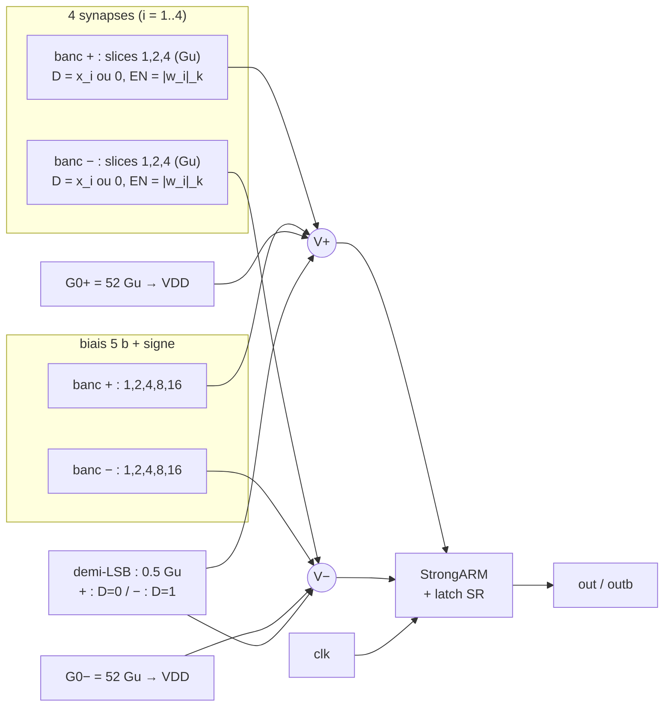

# ARCHI — Neurone Millman à synapses tri-state (sky130A) — v1

Chiffres : `calc/out/model_summary.txt`. Spécifications : `spec/SPEC.md`.

## 1. Principe

Chaque slice est un driver tri-state (sortie VDD, GND ou Hi-Z) suivi d'une résistance poly vers un nœud de
somme. Par le théorème de Millman, avec des conductances Gₖ (en unités Gu = 1/Ru) :

```
        Σ Gₖ·Vₖ        VDD · ( Σ G_à_1 + G0 )          D = Σ G_actives + G0 (indépendant des x)
  V  =  ───────   =   ──────────────────────────
        Σ Gₖ                     D
```

Deux nœuds V+ et V−. **Équilibrage par synapse** : une synapse de poids w > 0 active |w| unités sur V+
pilotées par xᵢ **et** |w| unités sur V− pilotées à 0 (et inversement si w < 0). Les deux nœuds ont alors
le même dénominateur D = Σ|wᵢ| + |b| + 0.5h + G0 pour tout code, et

```
  ΔV = V+ − V− = VDD · ( Σ wᵢ·xᵢ + b − 0.5·h ) / D        (exact, linéaire, LSB = VDD / D)
```

Cette solution remplace un banc d'équilibrage séparé (6 bits par nœud) : elle coûte exactement le même
nombre d'unités que les synapses et ne demande aucun calcul de code d'équilibrage.

G0 (52 Gu) est un pull-up vers VDD. C'est le Thévenin qui maximise le LSB tout en gardant V± ≥ 0.756 V,
au-dessus du bas de fenêtre d'un StrongARM NMOS. Un Thévenin vers VDD/2 avec ce comparateur est
impossible (`model_summary.txt`, option C) ; avec un comparateur rail-à-rail, il donnerait un LSB plus
petit (9.1 mV au lieu de 14.5 mV, option B).

## 2. Schéma bloc



Version ASCII :

```
 x1..x4 ─┐                                                    VDD   VDD
         │  ┌──────────── slice (i,+,k) ───────────┐           │     │
         ├─▶│ D ─▶ tri-state ─▶ R = Ru/k (xhigh_po)├──┬── V+ ──┤G0+  │G0−
 ctrl ──▶│  │ EN ─┘                                │  │        │     │
         │  └──────────────────────────────────────┘  │   ┌────┴─────┴───┐
         │       ... 12 slices + 5 biais + ½ LSB ─────┘   │ StrongARM    │── out
         │  ┌── slices (i,−,k), biais −, ½ LSB ──────┬─V−─┤ + latch SR   │── outb
         └─▶└────────────────────────────────────────┘    └──────▲───────┘
                                                                  clk
```

## 3. Blocs et dimensionnement initial

| Bloc | Contenu | Valeurs initiales (phase 1) |
|---|---|---|
| `synapse_slice` | driver tri-state (inverseur + interrupteurs pilotés par EN/ENB) + résistance | unité R_U = Ru/4 = **431 kΩ** : xhigh_po w = 0.35 µm, **L = 75.24 µm** ; poids 4 = 1 R_U, poids 2 = 2 R_U en série, poids 1 = 4 en série, poids 8 = 2 en parallèle, poids 16 = 4 en parallèle, demi-LSB = 8 en série |
| `millman_node` | G0 (13 R_U en // vers VDD), pas de MIM | C_nœud ≈ 470 fF (capa répartie, estimation), R_nœud = 15.5–33.2 kΩ |
| `comparator` | StrongARM à paire NMOS + latch SR (NAND) | paire d'entrée W·L = 12 µm² (2×(6/1) en centroïde commun + dummies), σ_os ≈ 2.4 mV |
| `twine_neuron` | 2 × (4 bancs synapse + banc biais + ½ LSB + G0) + comparateur | 124 unités R_U, 36 drivers |

**Driver** : Ron < 1.08 kΩ requis (1 % de Ru/16). La valeur sera mesurée en phase 2 (Ron à faible Vds en
N et en P, et appariement Ron_N/Ron_P, car l'écart se traduit en erreur de poids sur le bit 16).

## 4. Comparateur : choix et alternative

**Choix : StrongARM (NMOS) + latch SR.**
- Pas de consommation statique, sorties rail-à-rail, une seule horloge.
- La seule contrainte, une entrée en mode commun ≥ ~0.75 V, est satisfaite par construction avec G0
  vers VDD (V± ≥ 0.756 V @1.62 V).
- Le kickback (couplage grille-drain de la paire au front d'horloge) est absorbé par les ≈ 470 fF de
  capa répartie du nœud et rattrapé avant la décision suivante. À mesurer en phase 2.

**Alternative : comparateur double-tail (Schinkel 2007).** Un étage préamplificateur sépare la paire
d'entrée du latch.
- Kickback plus faible et fonctionnement à mode commun plus bas, ce qui autoriserait un G0 plus faible
  (LSB plus grand).
- Coût : environ 2× plus de transistors, deux phases d'horloge, et un offset du préampli à dimensionner.
- Retenu comme repli si le kickback mesuré dépasse LSB/4 ou si la fenêtre de mode commun réelle est
  plus étroite que prévu.

**Écarté : préampli en temps continu + latch.** Il consomme du courant statique, ce qui va à l'encontre
de S12.

## 5. Interface de contrôle (sources idéales en v1)

| Signal | Largeur | Rôle |
|---|---|---|
| `x[4]` | 4 | entrées binaires |
| `en_p[i][k]`, `en_m[i][k]` | 2 × 4 × 3 | EN des slices synapse (= bits de \|wᵢ\|, identiques sur + et −) |
| `d_p[i][k]`, `d_m[i][k]` | 2 × 4 × 3 | données : `d_p = xᵢ` si wᵢ > 0, sinon 0 ; `d_m = xᵢ` si wᵢ < 0, sinon 0 (`sel_sign`) |
| `bias_en[k]` | 5 | bits de \|b\| (identiques sur + et −) |
| `bias_sign` | 1 | `d_bp = 1, d_bm = 0` si b > 0, inversé si b < 0 |
| `half_en` | 1 | active le demi-LSB (V− piloté à 1, V+ piloté à 0) |
| `clk` | 1 | bas = reset du comparateur et stabilisation du nœud ; front montant = décision |
| `out`, `outb` | 2 | sortie mémorisée par le latch SR jusqu'à la décision suivante |

En v1, la logique de décodage (code signé → `en`/`d`) est réalisée en Python, qui génère les PWL.
En V2 elle serait synthétisée (registre de configuration).

**Chronogramme d'une évaluation (10 MHz, période 100 ns)** :

```
clk     ____________________/‾‾‾‾‾‾‾‾‾‾‾‾‾‾‾\____________
codes   X== nouveau code ===X=====================X== suivant
V±      ~~ stabilisation ≤ 50 ns ~~‾‾‾‾‾‾‾‾‾‾‾‾‾‾‾‾‾
out     ======== ancien =========X== nouveau (t_dec) ======
        0                     50 ns               100 ns
```

**Multiplexage temporel** : la même cellule évalue N neurones virtuels sur N périodes consécutives.
Python change les codes à chaque période et réinjecte les sorties cachées comme entrées.
Exemple du XOR 2-2-1 :
1. h1 = OU(x1, x2) ;
2. h2 = NON-ET(x1, x2) ;
3. y = ET(h1, h2).

Le XOR demande donc 3 périodes (300 ns).

**Lecture SAR** : avec `half_en = 1`, out = 1 ⇔ b ≥ 1 − Σw·x. La recherche dichotomique sur b ∈ [−31, 31]
donne s = 1 − b_min en 6 décisions, soit 600 ns.

## 6. Codes des fonctions logiques (2 entrées, x3 = x4 = 0, poids 0 ⇒ bancs en Hi-Z)

| Fonction | w1 | w2 | b | Σ+b sur 00 / 01 / 10 / 11 | Marge |
|---|---|---|---|---|---|
| ET | +2 | +2 | −3 | −3 / −1 / −1 / +1 | 1 LSB |
| OU | +2 | +2 | −1 | −1 / +1 / +1 / +3 | 1 LSB |
| NON-ET | −2 | −2 | +3 | +3 / +1 / +1 / −1 | 1 LSB |

Table complète, avec ΔV idéal en mV : `results/model_truth_tables.csv`.

## 7. Plan de test

| Phase | Test | Banc | Mesure (.meas / Python) | Critère |
|---|---|---|---|---|
| 2 | Ron des drivers | `tb_slice_dc` | V/I à ±50 mV | S14 |
| 2 | DC des poids (tous codes d'une synapse, biais, ½ LSB) | `tb_neuron_dc` | V+, V−, ΔV ; INL/DNL vs modèle | S5, S7, S15 |
| 2 | Fenêtre de mode commun du comparateur | `tb_comp_cm` | ΔV minimal résolu vs Vcm | S8 |
| 2 | Stabilisation au pire code (S = 19.5) | `tb_neuron_tran` | t à 0.5 LSB | S10 |
| 2 | Temps de décision vs ΔV, kickback | `tb_comp_tran` | t_dec(ΔV), ΔV_kick | S11, S17 |
| 2 | Offset, hystérésis | `tb_comp_offset` | rampe lente ± ou dichotomie | S13 |
| 2 | ET / OU / NON-ET, XOR 2-2-1 multiplexé | `tb_func` + `sim/run_xor.py` | sorties vs table | S16 |
| 2 | SAR | `sim/run_sar.py` | Σw·x lu vs modèle | S4, S6 |
| 2 | Puissance | `tb_power` | moyenne et statique (pire code) | S12 |
| 3 | Corners 5 MOS × R/C × 3 VDD × 3 T, Monte Carlo ≥ 200 (`*_mm`) | `sim/run_corners.py` | `results/corners_pre.csv` | toutes |
| 4–6 | Layout, DRC (Magic + KLayout), LVS (Netgen), PEX RC, re-simulation | flow OTA (`pex.tcl`, `sim_ota.sh`) | `results/post_vs_pre.csv` | toutes |
